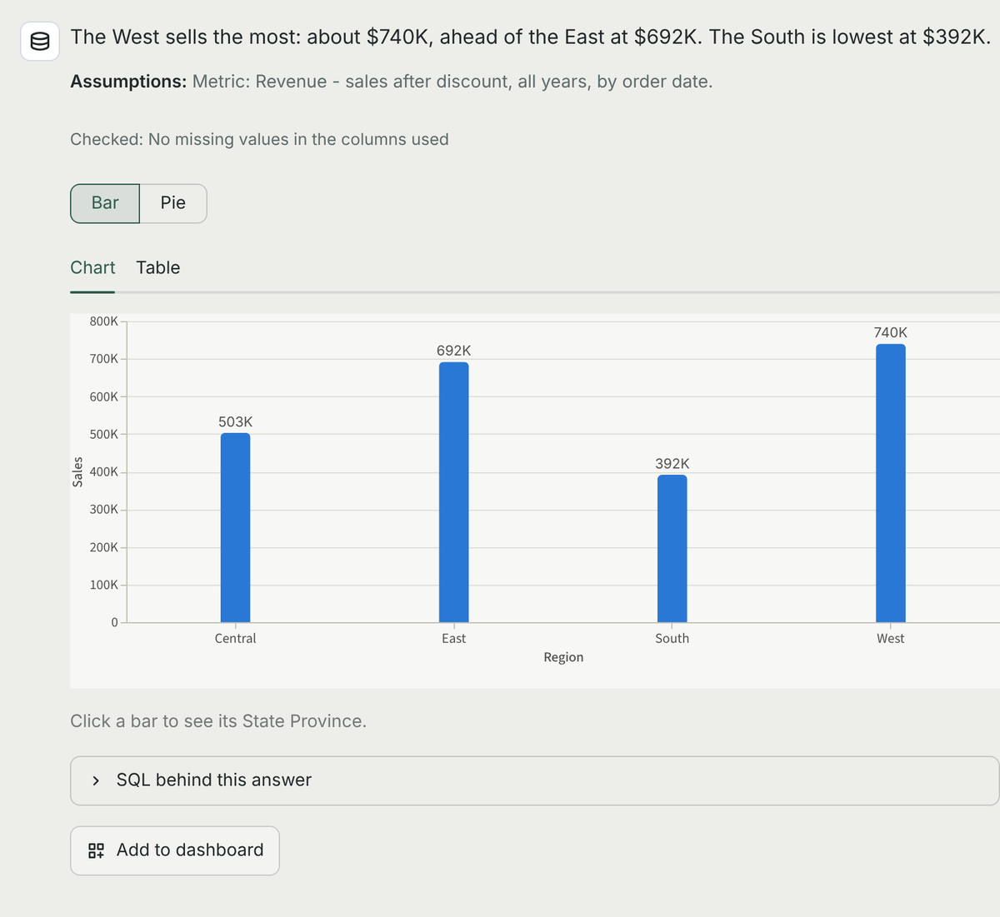
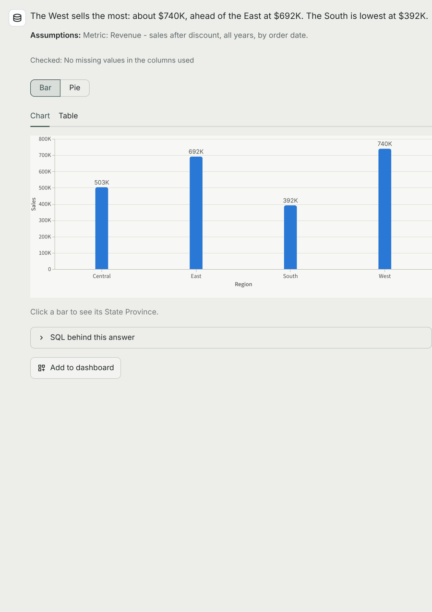
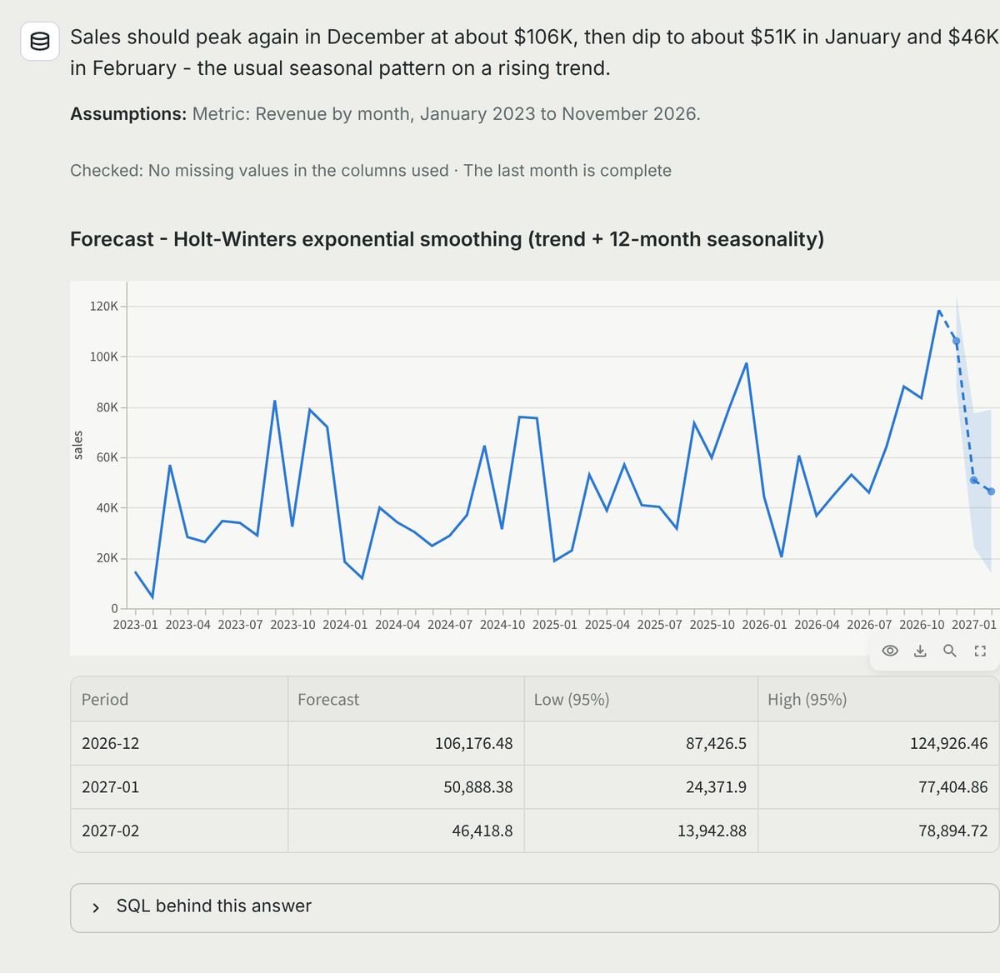
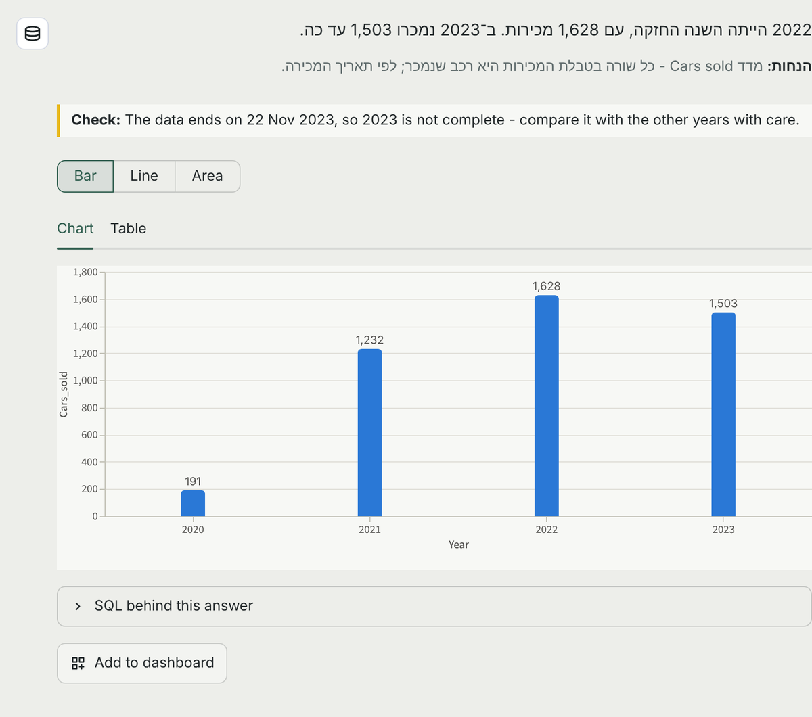
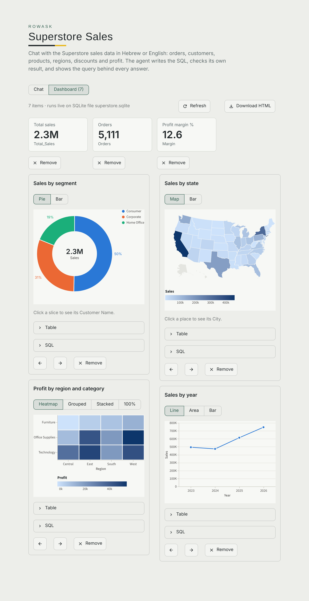
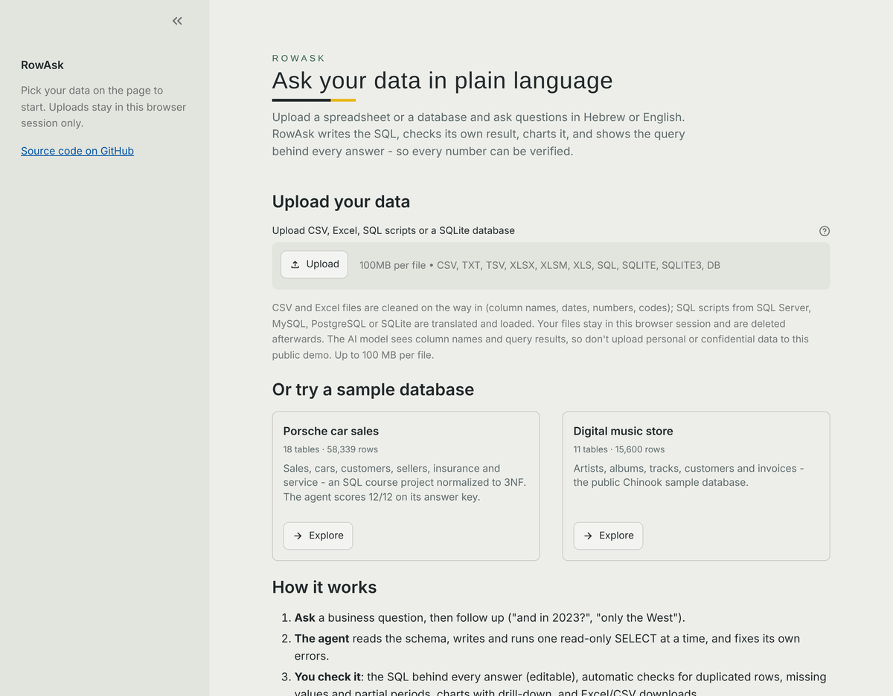
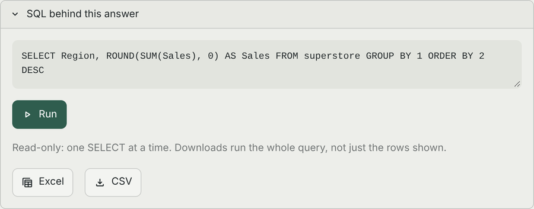
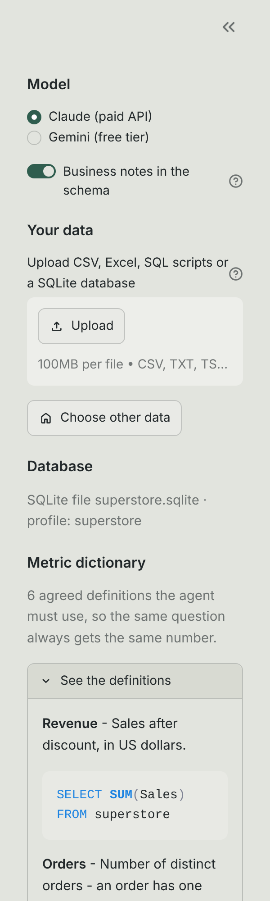

# RowAsk 🤖 – ask your database in plain language

**▶ Try it live: [rowask.streamlit.app](https://rowask.streamlit.app)** – no sign-up; open a sample database or upload
your own CSV/Excel file. (A free server: if it has been idle, it takes ~30 seconds to wake up.)

**RowAsk** is an AI agent that answers business questions about a database — in Hebrew or English. It reads the
schema, writes the SQL, runs it, checks its own result, fixes its own errors, and answers with the query it used, so
every answer can be verified. It works on SQL Server, PostgreSQL, SQLite and MySQL, or on your own CSV, Excel and SQL
files uploaded in the page. It was first built on my [Porsche sales database](https://github.com/kfirsh97/porsche-sales-database),
an SQL course project, which is still its main benchmark.

**Measured, not assumed:** 12/12 on the Porsche answer key, and 19/19 on a Superstore key built around traps and
business definitions (16/19 without the metric dictionary) - [how it's measured](#measuring-accuracy).

<p align="center"></p>

**Click to drill down** – region → its states → their cities, by rewriting the answer's own SQL (no model call):

<p align="center"></p>

| | |
|---|---|
| <br>**Forecasts and statistical tests** – prepared analyses, with honest ranges and verdicts | <br>**Hebrew, right to left** – and a check that catches an incomplete year |
| <br>**Dashboards** that rerun live, with pie, map and heatmap | <br>**Start anywhere** – upload a file or open a sample |
| <br>**The SQL behind every answer** – edit it, rerun it, download the whole result | <br>**A metric dictionary** – one agreed definition per business number |

**What it does**

- **A home page** to upload your own files or open a sample database (Porsche sales, a music store)
- **Chat** with follow-up questions, in a Streamlit web page or on the command line
- **Any database**, with a small profile file for what the data means; or **upload** CSV, Excel, SQL scripts, SQLite
- **Charts** drawn from the real rows (bar, line, pie, US and world maps, heatmap...), a chart-type switcher, and
  **drill-down**: click a region to see its states, then their cities
- **Dashboards** of pinned queries that rerun live, exported as one standalone HTML page
- **Edit the SQL** behind any answer and rerun it; download the whole result as **Excel or CSV**
- **Checks on every answer**: joins that repeat rows, empty values, incomplete periods; the agent's assumptions
  shown in one line
- **Forecasts and statistical tests**: prepared analyses the agent picks from - it never runs its own code
- **A metric dictionary**: one agreed definition per business number, used on every question
- **Answer keys** that measure accuracy, including trap questions
- **Hardened for a public site**: read-only on three layers, question limits, three rounds of independent code
  review with a test for every finding

*Screenshots: the app on the sample databases; the answer text in them is illustrative, the charts, tables, checks
and numbers are the app's real output.*

```
$ python agent.py "כמה מכירות היו בכל שנה?"
  step 1: get_schema            -> schema (3,185 chars)
  step 2: run_query SELECT YEAR(Sold_Date) AS Sale_Year, COUNT(*) ... -> 4 rows
  step 3: run_query SELECT COUNT(*) FROM Sales WHERE Sold_Date IS NULL -> 1 rows   (self-check: no sales lost)
מספר המכירות לפי שנה: 2020: 191 · 2021: 1,232 · 2022: 1,628 · 2023: 1,503
```

## How it works

A hand-written agent loop (~100 lines, no agent framework), so every decision is visible:

1. The model gets the question and two tools: **`get_schema`** (tables, columns, foreign keys, business notes)
   and **`run_query`** (one read-only SELECT, max 50 rows back).
2. Each turn the model either calls a tool or answers. SQL errors are sent back to it, so it corrects itself.
3. The loop stops at an answer, or after **8 steps** — it can never loop forever.
4. Every step is logged to `logs/` (question, each tool call, result, final SQL, time).
5. **It's a conversation.** The last 6 question/answer pairs go back to the model with each new message, so
   follow-ups work ("how many sales in 2022?" → "and in 2023?" → "only Turbo models"). Only the text of earlier
   turns is resent, not their tool calls, which keeps requests small. Messages that need no data
   ("thanks", "explain that query") get a direct reply without touching the database.

**Two model providers**, same tools, prompt and safety: Claude (`PROVIDER=claude`, the default) or Gemini (`PROVIDER=gemini`).

**Any database.** Nothing in the agent is tied to Porsche: it reads the structure of whatever database it is
connected to, and the SQL dialect (T-SQL, PostgreSQL, SQLite, MySQL) is told to the model from the connection.
What it knows *about* a database – what the business is, units and codes, example questions – lives in a small
profile file (`profiles/*.toml`). Tested here on three databases: Porsche on SQL Server and on SQLite, and the public
Chinook music-store database on SQLite and PostgreSQL. See [SETUP.md → Your own database](SETUP.md#your-own-database).

## Safety – three layers

| Layer | What it stops |
|---|---|
| Database user with `db_datareader` only | Any write, even if every other check failed |
| `validate_query()` before the database | Anything that is not a single SELECT: `DELETE`, `DROP`, `SELECT INTO`, `EXEC`, stacked statements, keywords hidden in comments — while allowing those words inside strings |
| Limits | 30 s per query, 50 rows to the model, 8 steps per question, 90 s per model call |

**On the public demo** (every visitor is a stranger): questions are capped per visit and per day; uploads are limited
to 100 MB, kept per browser session and swept after 6 hours; an uploaded SQL script is stopped after 120 s, and runs
with ATTACH, PRAGMA and extensions denied; HTML in answers is never rendered; the API key lives in the host's secrets,
never in the code. The hard ceiling on cost is the monthly spend limit set on the key itself.

## Reliability

The free Gemini tier is often overloaded. The agent retries with growing waits, and if the main model stays busy,
switches to a fallback model **before** the conversation starts (never mid-conversation, since a model may not accept
another model's turns). The SDK's hidden retries are disabled, so every wait is visible.

## Measuring accuracy

Talking to an agent proves nothing — so it is scored against an **answer key**: 12 business questions, each with the
query I wrote for the original course project (graded 100). For each question the agent's SQL and the expected SQL
are both executed and their **full results compared** (row order and extra columns ignored; whole numbers must match exactly).

```
python eval.py --notes off     # schema only
python eval.py --notes on      # schema + business notes (currency, units, value formats)
```

Results (Claude Sonnet 5.5, October 2026):

| Setup | Score | Avg tool calls | Avg time per question |
|---|---|---|---|
| Schema only | 11 / 12 | 3.6 | 14.0 s |
| Schema + business notes | **12 / 12** | **3.0** | **10.0 s** |

With the business notes (currency, units, value formats, how to compute a car's age) the agent answered every
question correctly, with fewer queries and faster. A fair caveat: this is one run of 12 questions, so the
difference between the two rows is a signal, not proof — repeated runs and more questions would tighten it.

Results with full details are saved in `eval_results/`.

**A second answer key, built around traps: Superstore.** 19 questions on the public Superstore sales sample
(`answer_keys/superstore.py`, SQLite), 10 of them traps - questions where a wrong query still runs and returns a
plausible number: counting order lines as orders, customers by name (804 IDs carry 800 names), an average of
ratios instead of a ratio of sums, the US when the table also holds Canada, "at least one" without DISTINCT.
The score reports the traps separately.

```
DB_PROFILE=superstore python eval.py
```

Every database can have its own key: copy `answer_keys/superstore.py` to `answer_keys/<profile>.py`. The checker
accepts rounding (17.2 matches 17.2188) but not a different number (2.6 ≠ 2.7) or a fraction for a percentage.
For a "which one is the highest" question, a sorted list whose first row is the answer counts (the agent often
shows the top 3 for context). A number the agent worked out itself instead of in SQL does not count, even when it is
right: the prompt asks for every stated number - percentage changes included - to come from the final query.

First run (Claude Sonnet 5.5, 30 October 2026): **13 / 16, traps 8 / 9**. All three misses were right answers in the
wrong shape: two ranked lists (top 3 states, all 12 months), which led to the ranked-list rule above, and one growth
rate the model computed in its head from two yearly totals, which led to the compute-in-SQL rule in the prompt.

| Run (Claude Sonnet 5.5) | Score | Trap questions | Avg tool calls | Avg time |
|---|---|---|---|---|
| 30 Oct 2026 – first run | 13 / 16 | 8 / 9 | 2.1 | 6.8 s |
| 1 Nov 2026 – after the two fixes | **16 / 16** | **9 / 9** | 2.1 | 5.6 s |

The growth rate is now computed in SQL, and both ranked lists count. One run of 16 questions is a signal, not proof;
the key is there to be rerun after every change.

## The metric dictionary

"Revenue", "active customer", "late shipment" - every business has its own definitions, and a model can't guess
them: by order date or ship date? the last 90 days of the data or of the calendar? A profile defines each metric
once (`[[metrics]]` in `profiles/*.toml`, see `metrics.py`): the expression, table, date column, filter, and the
words people use for it, in any language. The agent gets the dictionary with the schema, must compute a named
metric exactly that way, and says which definition it used. Every metric is run against the database when first
shown; one that doesn't run is left out and reported, so a typo can't hand the agent a broken definition. The
sidebar lists them.

This is what the warehouse tools call a semantic model, and their accuracy depends on it. To measure it here,
the Superstore answer key has three metric questions (17-19) whose answers follow the dictionary:

```
DB_PROFILE=superstore python eval.py --notes on    # with the dictionary
DB_PROFILE=superstore python eval.py --notes off   # without it: the "before" score
```

| Run (Claude Sonnet 5.5, 1 Nov 2026) | Score | Trap questions | Metric questions |
|---|---|---|---|
| Without notes or dictionary (`--notes off`) | 16 / 19 | 10 / 10 | 1 / 3 |
| With them (`--notes on`) | **19 / 19** | **10 / 10** | **3 / 3** |

Without the dictionary the agent guessed "active" as the last 12 months (704 customers instead of 442) and, asked
for the late shipment rate, rightly said the data doesn't define "late" and offered options. With it, both match the
agreed definitions. (The third miss was Canada's sales picked from a table of every country; the prompt now asks for
a final query that returns just the answer.)

## Analyses: forecast, comparing groups, correlation, unusual values

Some questions SQL can't answer honestly on its own: *what will sales be next quarter*, *is the East really more
profitable or is it chance*, *does discount move with margin*, *which customers are unusual*. For those the agent
calls `analyze` (`analysis.py`): it picks one analysis from a fixed list and names the columns of a query it wrote.

- **Forecast** - Holt-Winters exponential smoothing (trend, plus 12-month seasonality with 2+ years of history), with
  a ~95% range that widens the further ahead it goes; drawn as the history continuing in a dashed line and a band.
- **Compare groups** - Welch's t-test and Mann-Whitney for two groups, Alexander-Govern and Kruskal-Wallis for more,
  with the effect size; the verdict is "significant", "could be chance" or "mixed" when the two tests disagree.
- **Correlation** - Pearson and Spearman, with "moving together is not causing" in the answer.
- **Unusual values** - robust z-scores (median and MAD), so the outliers can't hide by inflating the average.

The agent never writes or runs code for this: the query goes through the same read-only checks, the statistics are
written and tested in advance (`tests/test_analysis.py` checks them on data with a known answer), and data that
can't support an analysis - totals instead of observations, too little history - gets a clear refusal the agent can
act on. On a public site that matters: an agent that ran its own Python could be talked into running anyone's.

## Checking every answer

The answer key measures the agent; these checks run on **every answer**, on the database itself, no model call
(`checks.py`):

- **Joins that repeat rows.** When the answer adds up a table joined to another on a column that repeats there
  (orders joined to payments on the order ID), each order is counted once per payment. Flagged with the count of
  repeated values.
- **Empty values** in a column the answer adds up or groups by - SUM and AVG skip them without a word.
- **An incomplete last period.** If the rows the query can see end on 14 December, December is not a full month,
  and its "drop" is an artifact. Flagged when that period is in the result.

The agent gets the warnings together with its query result and fixes the query or mentions them; the page shows
them under the answer, with a quiet line for the checks that passed. The agent also states its **assumptions** in one
line (which date, what counts as an order, filters it added), shown in its own box - the choices a reviewer
would otherwise have to dig out of the SQL.

## Run it

**Full step-by-step setup, from an empty Mac to a running chat: [SETUP.md](SETUP.md)**
(SQL Server in Docker, loading the data, the read-only user, keys, and a troubleshooting table).

Short version, once the database is running and loaded:

```bash
git clone https://github.com/kfirsh97/rowask && cd rowask
python3 -m venv .venv && source .venv/bin/activate
pip install -r requirements.txt
cp .env.example .env           # add your API key and the read-only user's password
python check_setup.py          # DB connection, read-only check, API key check
python -m streamlit run app.py # web chat on http://localhost:8501
python -m pytest tests         # 123 tests (3 need a PostgreSQL server), no API key needed
```

## Files

| File | Purpose |
|---|---|
| `agent.py` | The agent loop, prompt, providers, retries and logging |
| `tools.py` | `get_schema`, `run_query`, the SQL safety validator and the business notes |
| `eval.py` · `answer_keys/` · `compare.py` | Answer keys (Porsche: `eval_questions.py`; Superstore), the evaluation runner and result comparison |
| `checks.py` | Automatic checks on every answer: joins that repeat rows, empty values, incomplete periods |
| `app.py` | The web chat (Streamlit) |
| `db.py` | Connects to any database (SQLAlchemy); read-only sessions, 30-second query limit, dialect hints for the model |
| `dbprofile.py` · `profiles/` | Per-database knowledge: business line, notes, example questions |
| `upload.py` | Uploads on the web page: reading CSV/Excel, cleaning, building the session's database, describing it |
| `sqlimport.py` | SQL scripts from any dialect into SQLite: splitting, translating, IDENTITY values, foreign keys, the guard |
| `drill.py` | Drill-down: finds the next level in the data and rewrites the query for the clicked bar |
| `exports.py` | Excel and CSV downloads of a whole query result |
| `charts.py` · `dashboards.py` | Charts drawn from query rows (form, palette, marks); pinned dashboards and the HTML export |
| `data/` | SQLite copies: Porsche (built by `setup/build_sqlite.py`) and the Chinook sample database |
| `check_setup.py` · `setup/` · `SETUP.md` | Setup check, read-only user, SQLite builder, CSV importer, setup guide |
| `tests/` | Safety, agent loop (with a fake model), real-database tests on SQLite and PostgreSQL, comparison and evaluation |

## Web interface

```bash
python -m streamlit run app.py           # opens http://localhost:8501
DEMO=1 python -m streamlit run app.py    # replays two recorded runs - no database or API key needed
```

A chat: ask in Hebrew or English, then keep going with follow-up questions – the agent remembers the
conversation, and **New conversation** in the sidebar starts over. **Stop** ends a question mid-way: the agent
runs in the background, checks before every model call, and makes no more calls once stopped.

**Charts.** An answer that is a trend, a comparison or a single number gets a chart next to its table – the
model only suggests the encoding (bar, line, grouped bar, stat tile...), and the chart is drawn from the real rows of
its query, so it can never show a number the database didn't return. Ask for one in words too ("show it as a graph").
The form follows the data's job, there is only ever one y-axis, and the colors are a fixed, validated order
(color-blind checks run with the data-viz skill's validator); every chart has its table twin.

**Chart types.** Bar, line, area, grouped, stacked and 100% stacked bars, scatter, stat tiles, and:
- **Pie (donut)** – part of a whole, with the total in the middle. At most 6 slices (the rest fold into "Other"),
  never offered when a value is negative.
- **Map** – US states (names or codes like `CA`) or world countries, one hue from light to dark; places with no
  value stay gray. Offered only when most of the values are found on the map. Shapes: `geo/` (us-atlas and
  world-atlas, ISC license).
- **Heatmap** – two groupings and a measure (region × category, year × segment), darker = more.

Above every chart, a switcher shows only the forms that result can honestly take (a share can be a bar or a pie, a
list of states a map or a bar, region × category a grouped, stacked, 100% or heatmap chart). On a dashboard the
choice is saved with the card. Clicking a slice or a state drills down like a bar.

**Drill-down.** Click a bar to zoom into it: Region → its states → their cities, Category → sub-categories →
products. No model call: the answer's own SQL is rewritten (the clicked column swapped for the next level, a filter on
the clicked value added - joins, other filters and the measure untouched), so the drilled bars add up to the bar
that was clicked. The levels are found in the data: a column is the next level when its values nest inside the
clicked one (100% of states sit in one region, 89% of cities in one state; a cross-cutting dimension like Segment
appears in every region and is never offered). A breadcrumb row climbs back up. Works in the chat and on dashboards.

**Edit the SQL, download the result.** Under every answer, the query opens for editing: change it and press
**Run** – the chart and table redraw from your query (through the same read-only checks as the agent's), and
**Back to the original** returns to the agent's. **Add to dashboard** pins the query on screen, edited or not. On a
dashboard card, **Run and save** replaces the card's query. **Excel** and **CSV** download the whole result, run again
at the moment of the click (not just the rows on screen); the Excel file has a second sheet with the query, and the
CSV opens in Excel with Hebrew intact.

**Dashboards.** **Add to dashboard** under any answer pins its query. The **Dashboard** view runs every pinned query
again, live – headline numbers on top as stat tiles, charts below – with reorder, remove, refresh, and **Download
HTML**: one standalone page with the charts, the table and the SQL behind each, to send to someone without the app.

**Upload your own data** in the sidebar – CSV, Excel (every sheet becomes a table), **SQL scripts**, or a SQLite file.
A SQL script (CREATE TABLE + INSERT – a dump, or a course project like `data/porsche_sql/`) can be written for
SQL Server, MySQL, PostgreSQL or SQLite: it is translated where needed (sqlglot), server-only statements are skipped,
IDENTITY keys keep their original values, and foreign keys added later with ALTER TABLE are kept so the agent can
JOIN a normalized schema. Uploading this project's own two T-SQL files rebuilds all 18 tables and 58,339 rows exactly.
The script runs in its own database file under a guard that refuses anything able to reach outside it (ATTACH,
VACUUM INTO, PRAGMA, extensions).

CSV and Excel uploads: CSV and Excel
are cleaned on the way in and the page lists every change: SQL-safe column names, dates as `YYYY-MM-DD`, codes that
Excel turned into `77095.0` back to `77095`, `"$1,234"` and `"45%"` as numbers, curly quotes made plain, empty rows
dropped. Hebrew files saved by Excel on Windows are detected and read correctly. The agent also gets a description of
every column (values, ranges, dates), so it can query data it has never seen. Uploads are for that browser session
only – other people using the same page keep the default database. Watch each step as it happens: the schema read, every query with its row count,
then the answer, the result table and the SQL behind it. The sidebar switches between Claude and Gemini and
turns the business notes on or off.
